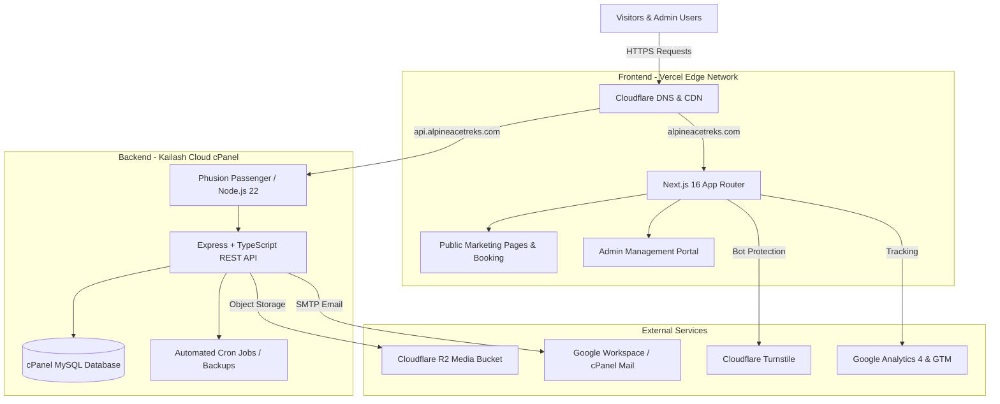

# 🏔️ Alpine Ace Treks & Expeditions - Project Documentation & Handover Guide

Welcome to the official technical documentation for the **Alpine Ace Treks & Expeditions** web platform. This document acts as the central master index and handover manual for the client, technical stakeholders, and future developers.

---

## 📌 Executive Summary

The **Alpine Ace** platform is a modern, high-performance web platform and Content Management System (CMS) purpose-built for Himalayan trekking, climbing expeditions, and adventure tours in Nepal.

The platform is architected into two decoupled, scalable systems:
1. **Frontend Web Application (`alpineace.com`)**: Built with **Next.js 16 (App Router)**, **React 19**, and **Tailwind CSS v4**, deployed on **Vercel** for edge-optimized delivery, sub-second load times, and top-tier SEO performance.
2. **Backend REST API (`alpineace--backend`)**: Built with **Node.js 22**, **Express**, **TypeScript**, and **TypeORM with MySQL**, deployed on **Kailash Cloud cPanel Node.js Hosting** (powered by CloudLinux Phusion Passenger).

---

## 📚 Documentation Index

| Documentation File | Contents & Purpose |
| :--- | :--- |
| **[FRONTEND.md](file:///docs/frontend.md)** | Complete Frontend overview, architecture, tech stack, and a comprehensive breakdown of all **Marketing** and **Admin Dashboard** pages. |
| **[BACKEND.md](file:///docs/backend.md)** | Backend overview, architecture, database schemas, API specs, background crons, security features, and environment variables. |
| **[DEPLOYMENT_CPANEL_BACKEND.md](file:///docs/deployment-cpanel-backend.md)** | Step-by-step production deployment guide for Kailash Cloud cPanel (File Manager, Terminal, "Setup Node.js App", MySQL, SSL). |
| **[DEPLOYMENT_VERCEL_FRONTEND.md](file:///docs/deployment-vercel-frontend.md)** | Production deployment guide for Next.js on Vercel, including Git connection, Environment variables, and Custom Domain DNS setup. |

---

## 🏛️ High-Level System Architecture



---

## 🔑 Quick Reference & Credentials Checklist

Before going live or during deployment, ensure you have the following access credentials handy:

| Service | Host / Interface | Credentials Required |
| :--- | :--- | :--- |
| **cPanel (Kailash Cloud)** | `https://kailashcloud.com:2083` or server IP | cPanel Username & Password |
| **cPanel MySQL** | cPanel -> MySQL Databases | DB Name, DB User, DB Password |
| **Vercel** | `https://vercel.com` | Vercel Account linked to GitHub repo |
| **Cloudflare R2** | Cloudflare Dashboard -> R2 | Account ID, Access Key ID, Secret Key, Public Domain |
| **Admin Portal** | `https://alpineacetreks.com/admin/login` | Super Admin Email & Password |
| **Cloudflare Turnstile** | Cloudflare Dashboard -> Turnstile | Site Key (Frontend) & Secret Key (Backend) |
| **SMTP Mail Server** | Gmail / Google Workspace / cPanel Mail | SMTP Host, Port, Mail User, App Password |

---

## 🛠️ Repository Directory Structure

```text
gray/
├── alpineace.com/                 # Frontend Web Application (Next.js 16)
│   ├── app/                       # Next.js App Router (Marketing & Admin routes)
│   ├── components/                # Reusable UI & Feature components
│   ├── lib/                       # Utilities, Contexts, Schemas, & API clients
│   └── public/                    # Static images, icons, and fonts
├── alpineace--backend/            # Backend REST API (Node.js + Express + TypeORM)
│   ├── src/                       # TypeScript source code
│   │   ├── controllers/           # TSOA API route controllers
│   │   ├── entities/              # TypeORM database models (MySQL)
│   │   ├── services/              # Business logic layer
│   │   ├── crons/                 # Background maintenance & backup jobs
│   │   └── templates/             # Email EJS templates
│   ├── dist/                      # Compiled production JavaScript
│   └── index.js                   # cPanel Passenger entry point
└── docs/                          # Project Documentation & Deployment Handover Guides
    ├── README.md                  # This file (Master Index)
    ├── frontend.md                # Frontend documentation & page catalog
    ├── backend.md                 # Backend architecture & API overview
    ├── deployment-cpanel-backend.md # Kailash Cloud cPanel deployment guide
    └── deployment-vercel-frontend.md # Vercel deployment & DNS setup guide
```
